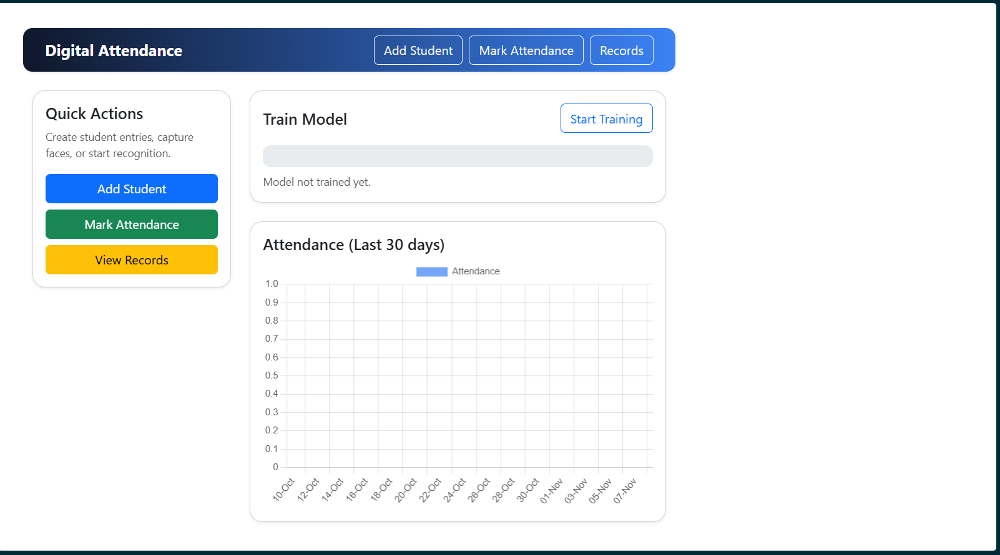

# Digital Facial Recognition Attendance System

An AI-powered **Digital Facial Recognition Attendance System** developed using Python, Flask, OpenCV, MediaPipe, and Random Forest Classifier. The system automates student attendance by detecting and recognizing faces through a camera and recording attendance in an SQLite database.

The project aims to reduce manual attendance efforts, improve efficiency, minimize proxy attendance, and provide an organized platform for student attendance management.

## 📸 Project Preview

## 📸 Project Preview



## ✨ Key Features

- **Face Detection:** Uses MediaPipe Face Detection to locate faces from camera images.
- **Image Preprocessing:** Performs face cropping, grayscale conversion, resizing, normalization, and feature extraction.
- **Machine Learning-Based Recognition:** Uses Random Forest Classifier to recognize registered students based on extracted facial features.
- **Automated Attendance:** Identifies students and records their attendance automatically.
- **Student Management:** Allows administrators to register and manage student information.
- **Attendance Records:** Maintains attendance information with timestamps.
- **Attendance Reports:** Supports daily, weekly, and monthly attendance monitoring.
- **Data Visualization:** Displays attendance statistics and analytical graphs through the dashboard.
- **CSV Export:** Allows attendance records to be downloaded for further analysis.

## 🧠 Methodology

The system follows a machine learning-based facial recognition pipeline.

1. **Image Acquisition:** Captures student facial images through a camera.
2. **Face Detection:** MediaPipe detects the face region from the captured image.
3. **Face Cropping:** Extracts the detected facial region.
4. **Preprocessing:** Converts the face into grayscale and resizes it to 32 × 32 pixels.
5. **Feature Extraction:** Flattens the processed image into a numerical feature vector and normalizes pixel values.
6. **Model Training:** Uses Random Forest Classifier to learn facial patterns from registered student images.
7. **Face Recognition:** Predicts the identity of a student using the trained classification model.
8. **Attendance Marking:** Records the recognized student's attendance in the SQLite database.

## 📊 Model Evaluation and Performance Analysis

To evaluate the performance of the Random Forest Classifier, multiple machine learning evaluation techniques and graphical visualizations are included.

### 1. Confusion Matrix

Evaluates the classification performance by comparing actual student labels with predicted student labels. It helps identify correctly classified students and misclassification between different classes.

### 2. Receiver Operating Characteristic (ROC) Curve

Visualizes the relationship between the True Positive Rate (TPR) and False Positive Rate (FPR) at different classification thresholds.

### 3. Precision-Recall Curve

Analyzes the trade-off between precision and recall and helps evaluate the model's ability to correctly identify registered students.

### 4. Out-of-Bag (OOB) Error Curve

Measures the classification error using out-of-bag samples during Random Forest training. It helps analyze model performance as the number of trees increases.

### 5. Preprocessing Visualization

Demonstrates the different stages of image preprocessing, including:
- Original RGB Image
- Grayscale Image
- Detected Face
- Cropped Face
- Resized Face
- Normalized Face
- Extracted Feature Representation

## 📈 Performance Metrics

The model is evaluated using the following metrics:

- Accuracy
- Precision
- Recall
- F1-Score
- Confusion Matrix
- ROC Analysis
- Precision-Recall Analysis
- Out-of-Bag Error Analysis

These metrics provide an overall understanding of the classifier's performance and its ability to distinguish between registered student identities.

## 🛠️ Technology Stack

| Category | Technologies |
|---|---|
| Programming Language | Python |
| Backend Framework | Flask |
| Face Detection | MediaPipe |
| Image Processing | OpenCV |
| Machine Learning | Scikit-learn |
| Classification Algorithm | Random Forest Classifier |
| Numerical Processing | NumPy |
| Database | SQLite3 |
| Frontend | HTML, CSS, JavaScript |
| Data Visualization | Matplotlib |
| Model Storage | Pickle |

## 🏗️ System Architecture

```text
       Student Registration
               |
               v
        Image Acquisition
               |
               v
        Face Detection
          (MediaPipe)
               |
               v
        Face Preprocessing
               |
               v
        Feature Extraction
               |
               v
       Random Forest Model
               |
               v
        Face Recognition
               |
               v
       Attendance Recording
               |
               v
        SQLite Database
               |
               v
       Attendance Dashboard
               |
               v
      Reports and Analytics
```

## 📁 Project Modules

| Module | Description |
|---|---|
| `app.py` | Flask application and backend routes |
| `model.py` | Face preprocessing, feature extraction, and machine learning pipeline |
| `templates/` | HTML pages and dashboard interfaces |
| `static/` | CSS, JavaScript, and frontend resources |
| `dataset/` | Student facial image dataset (kept locally, not published) |
| `attendance.db` | SQLite attendance database (generated locally) |
| `model.pkl` | Serialized trained classification model, if used by the application |
| `scaler.pkl` | Saved preprocessing scaler, if required |

## ⚙️ Installation and Setup

### Prerequisites

- Python 3.10 or compatible version
- pip
- Git
- Webcam or camera

### 1. Clone the Repository

```bash
git clone https://github.com/PrasoonDhiman/Digital-face-attendance.git
```

### 2. Navigate to the Project Directory

```bash
cd Digital-face-attendance
```

### 3. Create a Virtual Environment

```bash
python -m venv venv
```

Activate it on Windows:

```bash
venv\Scripts\activate
```

### 4. Install Dependencies

```bash
pip install -r requirements.txt
```

### 5. Run the Application

```bash
python app.py
```

### 6. Open in Browser

```text
http://127.0.0.1:5000
```

## 🎯 Applications

- Schools and Colleges
- Universities and Educational Institutions
- Training Centers
- Workshops and Seminars
- Institutional Attendance Management

## 🚀 Future Enhancements

- Face anti-spoofing and liveness detection.
- SMS and WhatsApp attendance notifications.
- Teacher and administrator authentication.
- Class-wise and section-wise attendance management.
- Improved recognition using advanced feature extraction techniques.
- Raspberry Pi and edge-device deployment.
- Enhanced model optimization and performance evaluation.

## 🔐 Privacy and Security

Student facial images and personal
